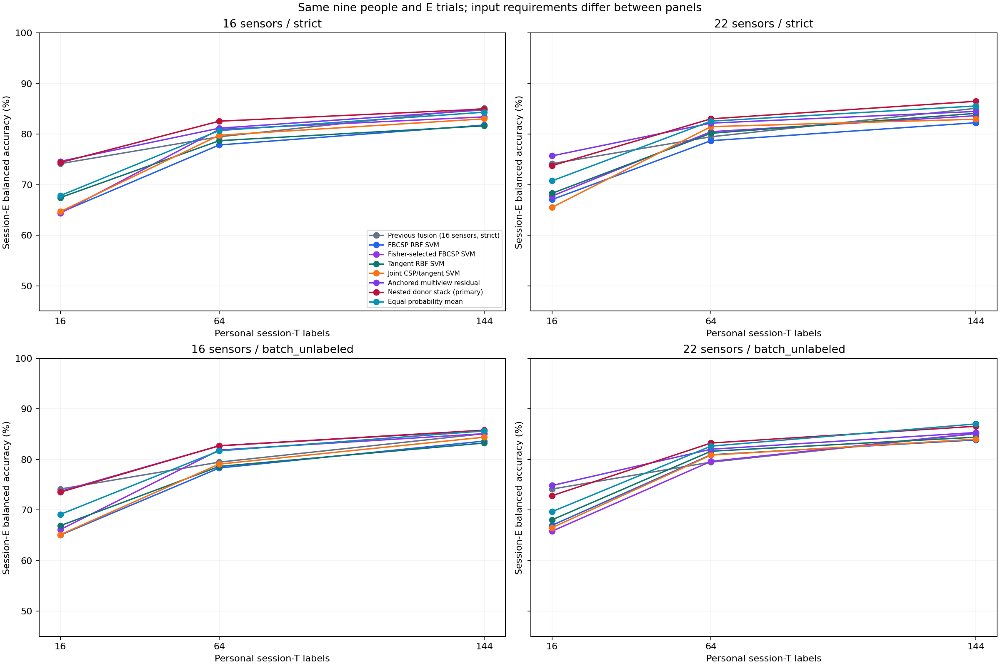
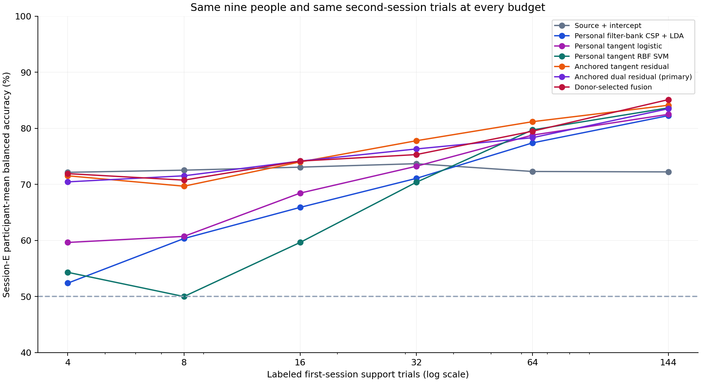

# NeuroEdge BCI

Reproducible offline EEG motor-imagery research. All documentation and reports
are in English. Complete models, real predictions, negative findings and
independent verification are retained.

Maintained by Alireza Pazouki. Source: [MIT](LICENSE). Dataset and artifact
license scope: [DATA_LICENSES.md](DATA_LICENSES.md). See [MODEL_CARD.md](MODEL_CARD.md).

## Download the complete research evidence

Clone or download this entire repository, then restore the archived models,
prediction tables and audit records with Python 3.11 or newer:

```bash
python scripts/restore_model_bundle.py --verify-only
python scripts/restore_model_bundle.py
```

No scientific dependencies are required for restoration. The command verifies
all archive parts and 5,619 restored files. Reports and aggregate comparisons
are directly visible in the repository. Large prediction tables and model
paths mentioned below become available after restoration; see
[ARTIFACTS.md](ARTIFACTS.md) for the exact distribution and integrity manifest.

## Latest v0.5 covariance expansion

The corrected study evaluates **71 configurations in 7,668 donor fits**, followed
by **972 selected model/stack fits**, on the same nine BNCI 2014_001 participants.
All 1,296 session-E left/right trials remain held out from parameter selection.
Budgets 16/64/144, 16/22 sensors and strict/batch-unlabeled inputs are separate.

The fixed primary 16-sensor strict donor stack scores **84.95%**, versus 85.11%
for the previous fusion: **-0.15 pp [-1.31, +1.16]**. It does not improve the
previous matched requirement. A secondary 22-sensor strict stack scores
**86.50%**, a descriptive **+1.39 pp [0.08, 2.85]** versus the old 16-sensor
pipeline. This is a whole-pipeline comparison with more electrodes.

| Condition, 144 first-session labels | Donor stack | Equal probability mean |
|---|---:|---:|
|16 sensors, strict |84.95%|84.34%|
|22 sensors, strict |86.50%|85.57%|
|16 sensors, batch-unlabeled |85.80%|85.65%|
|22 sensors, batch-unlabeled |86.57%|87.04%|

The 87.04% result uses the full unlabeled E batch for covariance alignment,
including future trials. It is not strict, causal or zero-calibration accuracy.
All rows need personal first-session labels;144 means the complete first-session
left/right calibration set. This previously inspected dataset makes the new
study exploratory. Intervals are descriptive and unadjusted for secondary
comparisons. The observed gains remain limited.



- [Complete new English report](runs/covariance_lab_corrected/REPORT.md).
- [Self-contained offline comparison](runs/covariance_lab_corrected/results.html).
- [Exact new methods and limits](docs/COVARIANCE_LAB_METHODS.md).
- [All 168 method/requirement conditions](runs/covariance_lab_corrected/summary.csv).
- [All 1,092 paired comparisons](runs/covariance_lab_corrected/all_pairwise_comparisons.csv).
- [Actual new predictions and model archives](ARTIFACTS.md).
- [Independent verification](runs/covariance_lab_corrected/verification.json).

Verification replayed and refitted all 972 saved artifacts, reconstructed 108
nested settings and checked all 7,668 donor candidate metrics and 217,728 actual
prediction rows. There are still only nine independent people. **94 software
tests passed** locally. The initial diagnostic run was invalidated after a
matrix-exponential prototype error; its source and audit evidence are retained,
and every final result was recomputed under a new corrected protocol.

With the complete native-artifact bundle and installed dependencies:

```bash
python scripts/restore_external_data.py
python scripts/freeze_covariance_inputs.py --plan configs/covariance_lab_corrected.yaml
python -m neuroedge.covariance_study all --plan configs/covariance_lab_corrected.yaml --workers 4
```

The input-freeze command verifies both original 16-sensor and new 22-sensor array
identities before final E scoring. For changed methods, data or incompatible
numerical environments use a fresh named configuration and output, preserving
all completed evidence. See ARTIFACTS.md for the GitHub distribution format.

Reproducible motor-imagery EEG research with participant isolation, cross-dataset
transfer, session-disjoint personal calibration, complete predictions and
independent checkpoint replay. All project documentation and reports are in English.

## Previous v0.4 result and its requirement

The exploratory cross-session study compares **11 methods at six label budgets**
on the same nine BNCI 2014_001 participants and 1,296 second-session left/right
trials, using 16 sensorimotor electrodes. The highest observed mean is **85.11%
balanced accuracy** for donor-selected fusion with **144 labeled first-session
trials**. Its descriptive participant interval is 76.93–92.52%.

This requires a complete first-session calibration. It does not replace the
zero-calibration result. The dataset had already been inspected; these new
experiments are exploratory, not a fresh independent-dataset confirmation.

| Method | 16 labels | 64 labels | 144 labels |
|---|---:|---:|---:|
| Fixed source ensemble, no personal labels | 72.15% | 72.15% | 72.15% |
| Source + same-budget intercept | 73.07% | 72.30% | 72.22% |
| Personal filter-bank CSP + LDA | 65.90% | 77.39% | 82.25% |
| Personal tangent logistic | 68.44% | 78.78% | 82.48% |
| Personal tangent RBF SVM | 59.65% | 79.71% | 83.64% |
| Proposed anchored tangent residual | 74.00% | 81.17% | 84.10% |
| Proposed anchored dual residual | 74.15% | 78.32% | 83.49% |
| Proposed donor-selected fusion | 74.15% | 79.48% | 85.11% |

The fixed primary comparison, anchored dual versus intercept with 16 labels,
is **+1.08 pp [-0.46, +2.62]** and does not establish a reliable positive gain.
At 144 labels, fusion is +12.89 pp [4.09, 23.15] versus intercept, but only
+1.47 pp [-0.23, 3.32] versus the stronger tangent SVM. The latter does not
establish reliable superiority. All intervals are descriptive and unadjusted
for the many secondary comparisons. Small-label failures are preserved.



- [Complete latest report](runs/session_adaptation/REPORT.md).
- [Interactive offline comparison](runs/session_adaptation/results.html): download and open locally.
- [Exact methods and selection rules](docs/SESSION_ADAPTATION_METHODS.md).
- [All 66 method/budget conditions](runs/session_adaptation/summary.csv).
- [Every participant result, restored from the archive](ARTIFACTS.md).
- [All 330 paired comparisons](runs/session_adaptation/all_pairwise_comparisons.csv).
- [Actual test predictions and model archives](ARTIFACTS.md).

## What was proposed

Anchored tangent and dual residuals preserve a fixed PhysioNet-trained ensemble
logit and fit a regularized correction from support-local covariance geometry
and spectral power. Donor-selected fusion combines personal decoders with the
intercept-adapted source. For each outer person, parameters are selected from
the other eight people's first-session data only. No second-session labels or
population statistics enter fitting or selection.

Budgets are the first chronological 4/8/16/32/64/144 left/right labels from
session T. All 144 session-E trials remain held out for every method and budget.
For the 144-label arm, donor parameter selection emulates 96 support trials so
later T runs remain available for validation; the final personal fit uses 144.
This mismatch and the dependence between donor cohorts are reported limitations.

These are proposed project-specific combinations of established ideas.
Filter banks, CSP, tangent classification, covariance alignment, residual
regularization and ensembling have prior art. This is not proof of worldwide
algorithmic novelty or superiority to unreproduced published methods.

## Earlier studies, preserved separately

| Evaluation | EEGNet reference | Selected ensemble | Requirement |
|---|---:|---:|---|
| Direct PhysioNet-to-BNCI transfer | 66.94% | 73.69% | No personal calibration; both BNCI sessions, 2,592 trials |
| External person-disjoint LOSO | 67.59% | 73.03% | Train on the other eight people's two sessions |

The original external choices froze before acquisition. The earlier source
screen compared 63 base configurations plus two matched gate variants, totaling
195 group fits. A previous frontier screen compared 224 configurations. All
negative findings remain: quality gating lost to its fixed control, and the
primary hybrid Gaussian personal kernel/16 scored 72.99% versus 73.07% for the
same-budget intercept. Different training/test conditions are never pooled
into one accuracy claim.

- [Overall earlier comparison](runs/research_summary/REPORT.md).
- [Context/symmetry methods](docs/CONTEXT_METHODS.md) and [full results](runs/context_fusion/REPORT.md).
- [Matched gates and personal calibration](docs/GATED_AND_PERSONAL.md).
- [Original personal kernels](docs/PERSONAL_KERNELS.md).
- [Frontier methods](docs/FRONTIER_METHODS.md) and [confirmation results](runs/frontier/REPORT.md).
- [Archived original channel/deployment benchmark](runs/main/REPORT.md).
- [Prior work and contribution](docs/RELATED_WORK.md).

The original 20-person benchmark achieved at most 54.8% participant-mean balanced
accuracy among its predefined conditions; EEGNet was near chance. INT 8 QDQ
ran slower on that CPU and did not always shrink artifacts. Those results are
retained rather than replaced by later higher numbers.

## Install

Python 3.12 and Linux CPU are the tested environment. No EEG hardware, paid API
or PhysioNet account is required. Large raw/processed caches are downloaded or
reconstructed locally and are excluded from version control.

```bash
python -m venv .venv
source .venv/bin/activate
python -m pip install torch==2.9.1 --index-url https://download.pytorch.org/whl/cpu
python -m pip install -r requirements-tested.txt
python -m pip install --no-deps -e .
python -m pytest -q
```

On Windows, activate `.venv\Scripts\Activate.ps1`; see
[SETUP_WINDOWS.md](docs/SETUP_WINDOWS.md). Actual latest dependency versions are
in `runs/session_adaptation/environment.json`; the full pinned environment is
in `requirements-tested.txt`.

## Inspect or reproduce

Open `runs/session_adaptation/results.html` after downloading the project. The
self-contained report requires no retraining. See [ARTIFACTS.md](ARTIFACTS.md)
for the distinction between repository contents and the full checkpoint bundle.

With the complete checkpoint bundle, reconstruct the archived external data
and rerun all latest checks:

```bash
python scripts/restore_external_data.py
python -m neuroedge.session_study all --plan configs/session_adaptation.yaml
```

The restore command verifies all 18 original MATLAB hashes and all five archived
processed fingerprints. An incompatible host must use a new run identity;
never remove a hash guard to force continuation. A new method or protocol must
use another YAML name and output directory, preserving completed results.

The latest study completed 1,350 donor fit/evaluation jobs, 540 saved final
fit/evaluation artifacts, 54 fusion evaluations and 85,536 test prediction rows.
Counts include repeated source controls; there are still only nine independent
participants. Verification replayed and refitted all 540 saved artifacts and
reconstructed 54 donor-only settings. All 330 paired comparison means were also
checked against actual per-class recalls. **82 software tests passed** locally.
GitHub-hosted CI status is separate from these local checks.

For fresh earlier studies, create named plans with `scripts/new_run.py` and
follow [CONTEXT.md](docs/CONTEXT.md), [GATED_AND_PERSONAL.md](docs/GATED_AND_PERSONAL.md)
or [FRONTIER.md](docs/FRONTIER.md). The original benchmark can be reproduced
with `neuroedge prepare/run/deploy/report/demo/verify --config` as documented
in [METHODS.md](docs/METHODS.md).

## Scope, attribution and licenses

This is offline, cue-aligned recorded EEG research. It does not establish
real-time brain control, clinical utility, MCU deployment or physical energy
savings. Model-only CPU timings omit acquisition and preprocessing. SVM
sigmoid decision scores are uncalibrated surrogates. Confidence intervals
are not equivalence tests or universal performance guarantees.

The code was developed with Codex assistance. The contributor remains
responsible for understanding and interpreting the work. See
[VALIDATION.md](VALIDATION.md), [THIRD_PARTY.md](THIRD_PARTY.md) and
[REFERENCES.bib](REFERENCES.bib).

Original source and project contributions: [MIT](LICENSE), copyright 2026
Alireza Pazouki and NeuroEdge contributors, to the extent of project-owned
rights. PhysioNet EEGMMIDB retains ODC Attribution 1.0; BNCI2014_001 retains
CC BY-ND 4.0, Institute for Knowledge Discovery, Graz University of Technology.
Raw EEG and recorded-signal replay pages are excluded from this publication.
See [DATA_LICENSES.md](DATA_LICENSES.md) for retained third-party content, model
artifacts and the exact scope. Neither dataset is relicensed under MIT.
