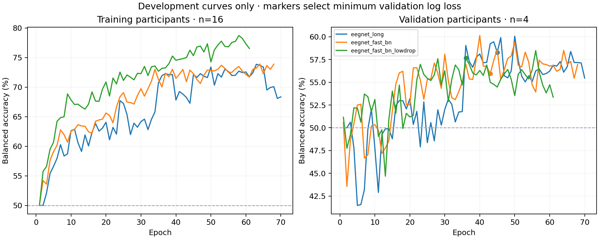

# NeuroEdge v0.2 — prospective confirmation

The v0.1 20-participant cohort is now development data. All candidate choices used subjects 1–16 for fitting and 17–20 for validation. Subjects 21–30 were reserved for confirmation and acquired/scored only after selection was frozen. This is a new participant holdout, not a rerun of the v0.1 five-fold benchmark.

Fixed channels: 16; training seed: 7; selected candidate: eegnet_long. Its development balanced accuracy was 0.583. All final models refit using the 20 development participants. Neural epoch counts were frozen before confirmation; the old-settings neural baseline uses a fixed 25 epochs. No confirmation data are used for scaling, tangent reference, checkpoint selection or calibration.

| Model | Confirmation participants | Balanced accuracy | Descriptive 95% participant interval | Accuracy |
|---|---:|---:|---:|---:|
| csp_lda | 10 | 0.587 | [0.528, 0.656] | 0.593 |
| eegnet_long | 10 | 0.565 | [0.526, 0.606] | 0.564 |
| eegnet_old_settings_25epochs | 10 | 0.576 | [0.520, 0.639] | 0.573 |

## Interpretation boundaries

Use the baselines measured on these same confirmation participants for comparisons. Do not subtract the v0.1 54.8% score: it used different evaluation participants and training sizes. Ten participants, one training seed, one validation split and one public dataset give a pilot result, not a universal performance guarantee. Intervals are conditional descriptive participant bootstrap intervals. The four-band CSP uses extra fixed zero-phase filters on the existing offline epochs. The tangent model uses OAS covariance, per-trial unit-trace normalization, a training-fitted Riemannian tangent reference with tsupdate=False, training-fitted feature scaling, and logistic regression. It uses no evaluation-batch reference. Longer neural training and BatchNorm momentum changes were candidates, not assumed improvements. No clinical, real-time, MCU, energy, algorithmic-novelty or state-of-the-art claim.

## Reproduction

Run python -m neuroedge.accuracy_v2 develop --plan configs/accuracy_v2.yaml, then confirm, then verify. Existing frozen runs are preserved. See development_summary.csv, selection.json, confirmation_started.json, the confirmation CSV files, individual model artifacts and training histories.

## Derived comparisons and visualizations

Paired descriptive differences below compare the selected model with baselines on the same ten participants.

| Baseline | Mean balanced-accuracy difference | Descriptive 95% participant interval |
|---|---:|---:|
| csp_lda | -2.22 percentage points | [-7.81, +3.36] |
| eegnet_old_settings_25epochs | -1.12 percentage points | [-6.85, +4.07] |

[Recorded-data replay](demo/replay.html) shows the first three chronological trials of the first four confirmation participants, without selection by correctness. Sixteen channels feed the model; eight are displayed. Predictions are stored outputs.
