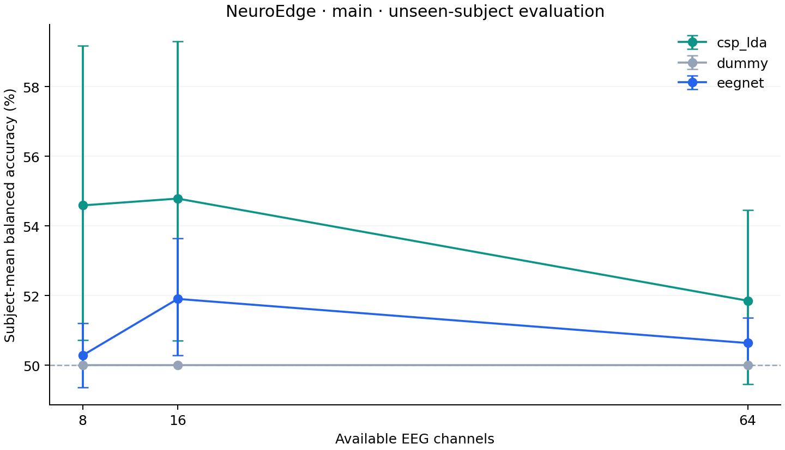
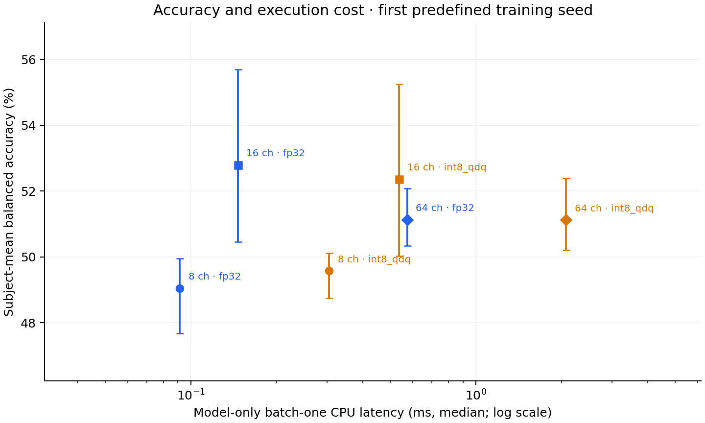

# NeuroEdge — main research report

Scope: fixed 20-subject engineering benchmark; exploratory; no novelty claim

## Question and design

How do predefined channel reductions affect left/right motor-imagery decoding on unseen participants? A separate deployment study compares FP32 and training-calibrated INT8 QDQ inference. This is an independent engineering reproduction, with no claim of algorithmic novelty.

Cohort: 20 fixed participants. Runs 4, 8, 12 only. Outer folds: 5; EEGNet seeds: [7, 17, 27]. Inner validation participants are disjoint from both training and test. Classical and neural models use the same training participants.

Methods: fourth-order zero-phase Butterworth 8–30 Hz, resampling to 128 Hz, one [1,4) second epoch per imagery event, configuration-specific average reference. CSP uses four components and fixed covariance shrinkage; LDA uses automatic shrinkage. EEGNet-8,2 uses a 32-sample temporal kernel, Adam, validation-loss early stopping, and per-channel scaling fitted on training trials only. See docs/METHODS.md.

## Measured results

| Model | Channels | Participants | Balanced accuracy | 95% participant-bootstrap interval | Macro-F1 |
|---|---:|---:|---:|---:|---:|
| csp_lda | 8 | 20 | 0.546 | [0.507, 0.592] | 0.491 |
| csp_lda | 16 | 20 | 0.548 | [0.507, 0.593] | 0.487 |
| csp_lda | 64 | 20 | 0.519 | [0.495, 0.545] | 0.435 |
| dummy | 8 | 20 | 0.500 | [0.500, 0.500] | 0.336 |
| dummy | 16 | 20 | 0.500 | [0.500, 0.500] | 0.336 |
| dummy | 64 | 20 | 0.500 | [0.500, 0.500] | 0.336 |
| eegnet | 8 | 20 | 0.503 | [0.494, 0.512] | 0.375 |
| eegnet | 16 | 20 | 0.519 | [0.503, 0.537] | 0.412 |
| eegnet | 64 | 20 | 0.506 | [0.500, 0.514] | 0.382 |

## Interpretation

The largest observed point estimate among the predefined configurations was 54.8% for csp_lda with 16 channels. EEGNet point estimates ranged from 50.3% to 51.9% across channel configurations. This describes the prespecified comparison; it is not an independently confirmed model-selection result. Binary balanced-accuracy chance is 50%. These results do not support a claim of a high-performing practical BCI. Investigating data sufficiency, optimization, or subject calibration would require a separately specified experiment using training/validation evidence.

Intervals resample participants after averaging repeated seeds within each participant. They describe this fixed cohort, not all possible EEG users. Paired differences are in paired_channel_differences.csv. Overlapping intervals do not establish equivalence or non-inferiority.

## Deployment status

Completed FP32 exports: 15; runnable INT8 QDQ models: 15; planned fold/channel exports: 15. See deployment/results.csv and deployment/README.md for measured costs and failures.

| ONNX variant | Channels | Test participants | Balanced accuracy | Mean artifact KiB | Pooled p50 ms | Pooled p95 ms |
|---|---:|---:|---:|---:|---:|---:|
| fp32 | 8 | 20 | 0.490 | 11.92 | 0.091 | 0.204 |
| fp32 | 16 | 20 | 0.528 | 12.42 | 0.146 | 0.327 |
| fp32 | 64 | 20 | 0.511 | 15.42 | 0.574 | 0.891 |
| int8_qdq | 8 | 20 | 0.496 | 13.41 | 0.305 | 0.526 |
| int8_qdq | 16 | 20 | 0.524 | 13.53 | 0.537 | 0.871 |
| int8_qdq | 64 | 20 | 0.511 | 14.28 | 2.072 | 2.603 |

Deployment uses only the first predefined training seed; the earlier EEGNet table averages all training seeds. Do not attribute that difference to export or quantization. Timing percentiles pool saved calls across the corresponding outer-fold models. The main pipeline measures deployment only after its planned training completes; shared-host scheduling can still affect timing. INT8 QDQ is mixed precision.

## Training budget actually used

EEGNet fits: 45; epochs executed per fit: 9–25; selected checkpoint epochs: 1–25. Complete training/validation curves are retained in each experiment's history.csv. Validation loss, not test accuracy, determined the saved checkpoint.

## Limitations

One public dataset and a small fixed cohort; no independent external dataset; no hyperparameter search. Small validation cohorts and limited epochs can disadvantage the neural model. Offline zero-phase filtering and cue-aligned epochs do not establish real-time or asynchronous BCI performance. This task does not establish a causal neurophysiological explanation for the classifier's decisions. Inference latency excludes electrode acquisition, the 3-second signal window, EDF reading, filtering, and resampling. Channel ablation on recorded 64-channel data does not measure physical acquisition power. CPU benchmarks do not demonstrate microcontroller deployment. No clinical or state-of-the-art claim.

## Related work

- Lawhern et al. (2018), EEGNet. DOI: 10.1088/1741-2552/aace8c.
- Schalk (2009), EEG Motor Movement/Imagery Dataset. DOI: 10.13026/C28G6P.
- Schalk et al. (2004), BCI2000. DOI: 10.1109/TBME.2004.827072.
- Wang et al. (2020), EEGNet-based low-power edge computing. DOI: 10.1109/MeMeA49120.2020.9137134.
- Wang et al. (2024), MI-BMInet. DOI: 10.1109/JSEN.2024.3353146.
- Tuimebay et al. (2026), low-channel EEG configurations and temporal segmentation. DOI: 10.3390/a19070588.

## Next experiment

Freeze the present findings, then evaluate a separately specified cross-dataset or cross-session protocol. Review close prior work before proposing a novel method. Do not tune on the outer-test outcomes reported here.
